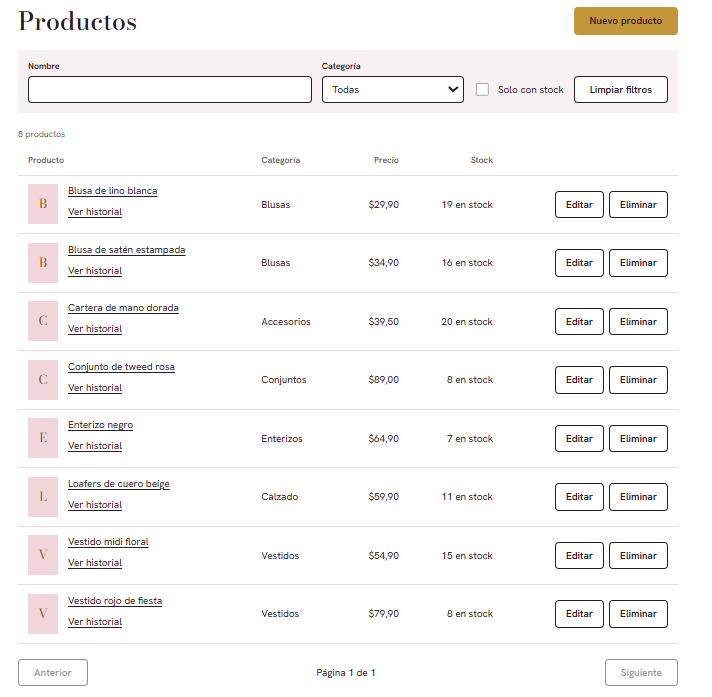
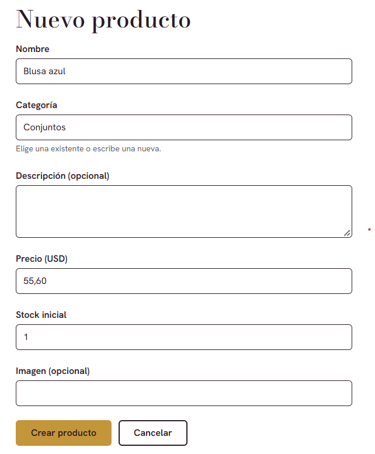
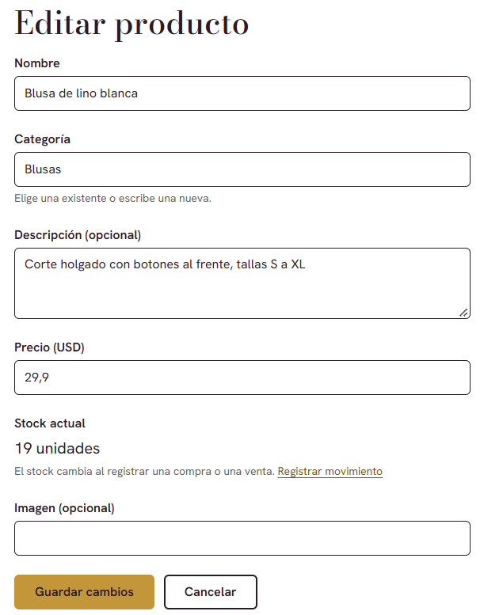
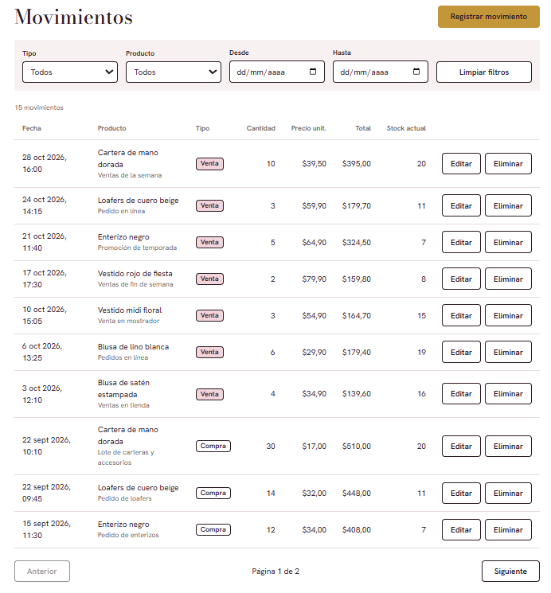
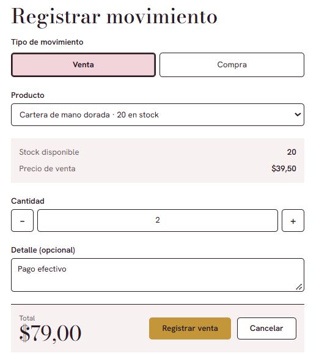
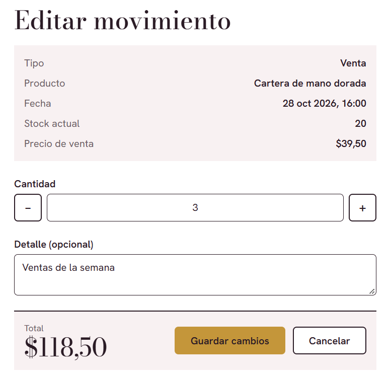
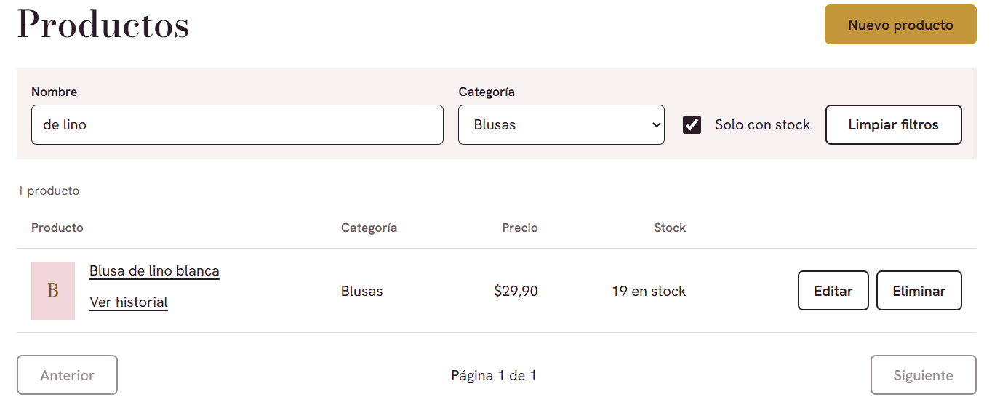
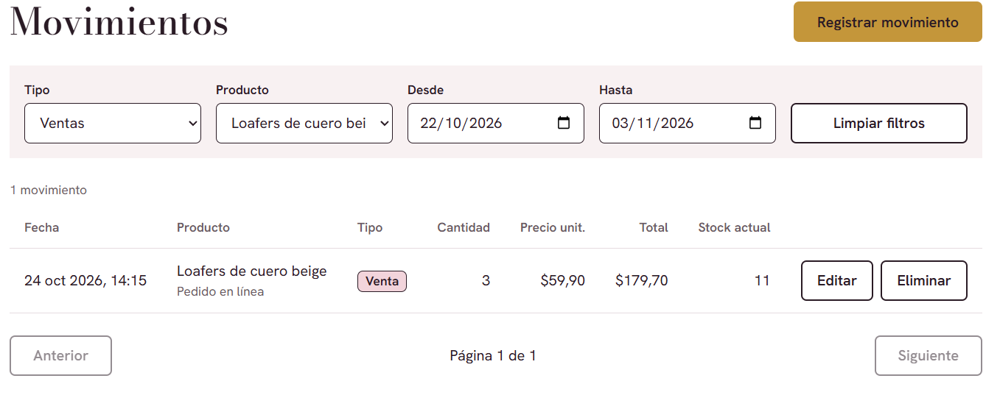
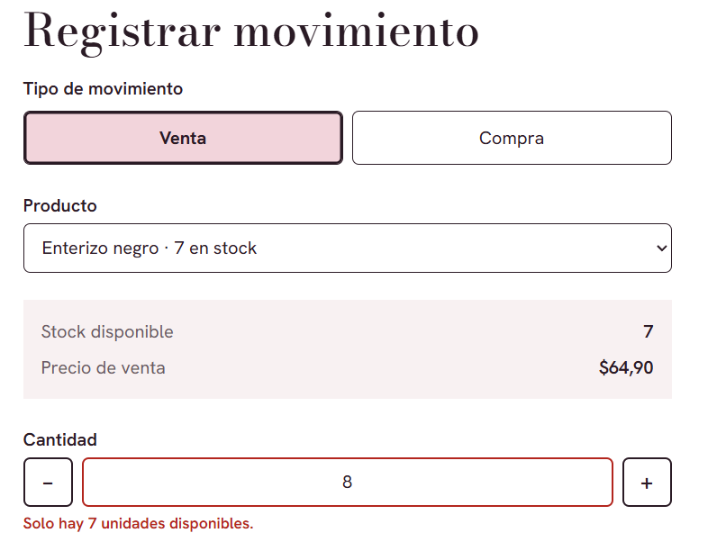
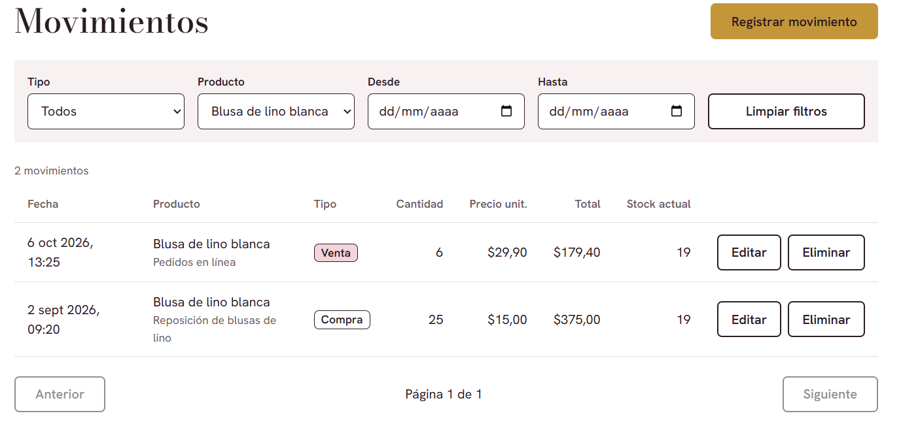

# JM Boutique · Inventario

Aplicación de inventario para una boutique de ropa femenina. Permite administrar productos y registrar compras y ventas, con historial por producto. Está formada por dos microservicios en .NET y un frontend en Angular.

## Contenido

- [Requisitos](#requisitos)
- [Base de datos](#base-de-datos)
- [Ejecución del backend](#ejecución-del-backend)
- [Ejecución del frontend](#ejecución-del-frontend)

## Requisitos

- [.NET SDK 10](https://dotnet.microsoft.com/download)
- [Node.js](https://nodejs.org/) LTS y npm 11 o superior
- Angular CLI: `npm install -g @angular/cli`
- SQL Server (Express, Developer o LocalDB) y una herramienta para ejecutar scripts (SSMS, Azure Data Studio o `sqlcmd`)
- Git

## Base de datos

1. Ejecuta `script.sql` (en la raíz del repositorio) sobre tu instancia de SQL Server.
   Crea la base `InventoryDb`, las tablas `Products` y `Transactions`, sus índices y datos de ejemplo.
   El script se puede ejecutar más de una vez sin duplicar datos.

   ```bash
   sqlcmd -S localhost -i script.sql
   ```

2. Guarda la cadena de conexión con **User Secrets**, para no subir credenciales al repositorio. Hazlo en cada servicio:

   ```bash
   cd backend/ProductService
   dotnet user-secrets set "ConnectionStrings:InventoryDb" "Server=localhost;Database=InventoryDb;Trusted_Connection=True;TrustServerCertificate=True"

   cd ../TransactionService
   dotnet user-secrets set "ConnectionStrings:InventoryDb" "Server=localhost;Database=InventoryDb;Trusted_Connection=True;TrustServerCertificate=True"
   ```

   Ajusta `Server` y la autenticación a tu entorno. Con usuario y contraseña:
   `Server=localhost;Database=InventoryDb;User Id=sa;Password=<tu-password>;TrustServerCertificate=True`.

## Ejecución del backend

Abre **dos terminales**, una por servicio, y deja ambas en ejecución.

```bash
# Terminal 1 · Productos → http://localhost:5001
cd backend/ProductService
dotnet run --launch-profile http
```

```bash
# Terminal 2 · Transacciones → http://localhost:5002
cd backend/TransactionService
dotnet run --launch-profile http
```

Notas:

- Inicia primero `ProductService`: `TransactionService` lo consulta para validar productos y ajustar el stock.
- El perfil `http` evita el certificado HTTPS de desarrollo. Si prefieres HTTPS, los puertos son 7001 y 7002, pero tendrías que actualizar `Services:ProductService:BaseUrl` y el `environment.ts` del frontend.
- Con el perfil `http` el estado se ve en `http://localhost:5001/openapi/v1.json` y `http://localhost:5002/openapi/v1.json`.
- CORS solo permite el origen `http://localhost:4200`. Se configura en `appsettings.json`.

## Ejecución del frontend

```bash
cd frontend
npm install
npm start
```

Abre `http://localhost:4200`.

Las URLs de las APIs están en `frontend/src/environments/environment.ts`:

```ts
export const environment = {
  productsApiUrl: "http://localhost:5001/api",
  transactionsApiUrl: "http://localhost:5002/api",
};
```

Para generar la versión de producción: `npm run build`.

## Evidencias

> Capturas de la aplicación en funcionamiento (carpeta `docs/evidencias/`).

### Listado de productos con paginación



### Creación de un producto



### Edición de un producto



### Listado de transacciones con paginación



### Registro de una transacción



### Edición de una transacción



### Filtros dinámicos




### Validación de stock insuficiente



### Pantalla para la consulta de información de un formulario (extra)


